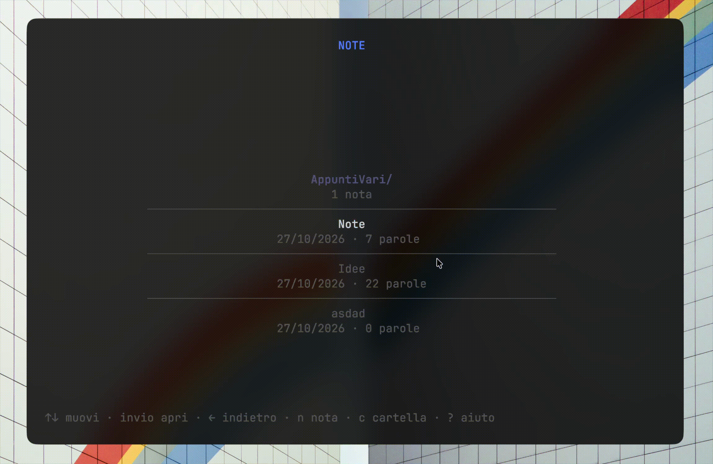

<p align="center">
  
</p>

**Nook** is a terminal markdown note editor written in Go with [Bubble Tea](https://github.com/charmbracelet/bubbletea). Notes are plain `.md` files in `~/.nook`, organised in real folders, and are written with a **Focus Line**: the line you are typing always stays in the middle of the screen as raw markdown, while the rest of the document scrolls around it already rendered (headings, bold, links, quotes, lists and checkboxes without their markers).

<p align="center">
  
</p>

## Why Nook

- **Write without distractions.** The cursor doesn't move: the text does. Your eye always stays on the same spot.
- **Real markdown, nicely seen.** Only the focused line shows raw text; the others are rendered with coloured styles and a fixed, muted palette.
- **A menu for your notes.** A list centred on the selected entry, nested folders, a trash with restore, title filter, rename and on-the-fly creation.
- **Keyboard and mouse.** Every action has a shortcut; click, double click, triple click, drag and wheel/touchpad scrolling work as you would expect.
- **Nothing hidden.** Notes are ordinary markdown files and folders in `~/.nook`: read them, back them up or sync them with any tool. Deletion is soft: a trashed note can be recovered until you delete it forever.

## Installation

Requires Go 1.26 or later.

```sh
git clone <repository-url> nook
cd nook
go build -o nook .
```

With the `Makefile`: `make build`, `make run`, `make test`, `make vet`, `make fmt`.

## Usage

```sh
./nook
```

On start-up the note list opens; from there you create, open, rename and trash
notes. Everything lives in `~/.nook` (change it with `notes_dir` in the
[configuration](#configuration), or `NOOK_DIR`): every note is a
`<title>.md` file and every folder is a real directory, so you can edit them with
any other editor too. Deleted notes are not erased but moved to the hidden
`~/.nook/.trash` folder, from where they can be restored. Only `.md` files and
folders are shown, any other file in the folder is left alone.

Nook uses its dark colour theme by default. Switch to the light one, follow the
terminal's background, or write your own in the [configuration](#configuration)
(`theme = "light"`), or for a single run with `NOOK_THEME=light ./nook`.

## Note list

Entries sit in a card at most 60 columns wide, centred horizontally and vertically
on the selected entry. Each entry takes two lines: the name and, below it, a
detail (`date · N words` for notes, `N notes` or `empty` for folders). Each entry
is separated from the next by a `─` line. The title at the top is `NOOK`, with
the folder path when you go down (`NOOK › projects`), or `TRASH` in the trash view.

### Folders

Folders sit at the top of the list (name with a `/` suffix, own colour) and can be
nested. Notes are created in the folder you are currently in. Trashing a folder
sends its subfolders and all the notes it contains to the trash too; a note
restored from a trashed folder returns to the root.

| Key | Action |
|---|---|
| `↑` / `↓` | move the selection (stays centred) |
| `enter` / `→` | open the note, or enter the folder |
| `←` / `esc` | go up to the parent folder |
| `c` / `ctrl+k` | new folder |
| `n` / `ctrl+n` | new note (in the current folder) |
| `r` / `ctrl+r` | rename |
| `d` / `ctrl+d` | trash (soft delete) |
| `o` / `ctrl+o` | toggle list ↔ trash |
| `u` | restore (trash only) |
| `x` / `ctrl+x` | delete forever (trash only) |
| `f` / `ctrl+f` | filter by title |
| `?` | help |
| `q` / `ctrl+q` / `ctrl+c` | quit |

In input popups (`n`, `r`, `f`) `enter` confirms and `esc` cancels. In confirmation
popups (`d`, `x`) `y` or `enter` confirm, `n` or `esc` cancel.

Mouse: a click selects the entry, a double click opens the note or enters the
folder.

## Editor

The **Focus Line** always stays on the middle row: as you move, the text scrolls,
not the cursor. The Focus Line shows **raw** markdown; every other line is
rendered, with markers hidden (`#`, `**`, `[]()`) and coloured styles for bold,
italic, code, links, strikethrough, quotes, lists and checkboxes. Quotes
(`> text`) are italic and flanked by a vertical bar `▌` running along the whole
block, consecutive lines included — even the Focus Line, which shows the raw `>`
but keeps the bar. Lines that are not in focus use a muted palette that is
**fixed** and identical for all of them: the dimming does not depend on the
distance from the Focus Line. Long lines are truncated with `…` (see
[Reading mode](#reading-mode) to read them in full).

Horizontal rules (`---`, `***`, `___`) are drawn as a full-width line, and fenced
code blocks (```` ``` ```` or `~~~`) as a shaded panel closed by a top edge that shows
the language (`┌─ go ────`) and a bottom edge (`└────`); the code inside is shown
as written, with no markdown applied.

Tables (a header row, a `|---|:-:|--:|` separator row and the rows below) are drawn
with `│` borders, a `├─┼─┤` rule under the header and every column padded to its
widest cell, honouring the `:` alignment marks; inline styles work inside cells.
The Focus Line of a table row still shows the raw text.

| Key | Action |
|---|---|
| `ctrl+s` / `F2` | save (confirmation toast) |
| `esc` / `ctrl+q` | back to the list; with unsaved changes opens the *Save / Discard / Cancel* popup |
| `ctrl+p` | turn [reading mode](#reading-mode) on / off |
| `ctrl+c` | quit immediately |
| `ctrl+shift+c` / `ctrl+shift+y` | copy the selection (see below) |
| `↑` `↓` `←` `→` | move |
| `home` / `end` | start / end of line |
| `ctrl+home` / `ctrl+end`, `ctrl+↑` / `ctrl+↓` | start / end of document |
| `pgup` / `pgdn` | page |
| `ctrl+←` / `ctrl+→` (or `alt+←` / `alt+→`) | word backward / forward |
| `shift+arrows`, `shift+home`/`end`, `shift+ctrl+←/→` | selection |
| mouse drag | select from the pressed point to the cell reached |
| `backspace` / `delete` / `enter` | delete / delete forward / new line |
| `alt+backspace` | delete the previous word |
| `ctrl+u` / `ctrl+k` | delete to start / end of line |
| `ctrl+shift+z` / `ctrl+y` | undo / redo (see below) |

In the *Save / Discard / Cancel* popup: `←`/`→` choose, `enter` confirms, `esc`
returns to the editor.

The selection is visible: selected text is highlighted both on the (raw) Focus
Line and on rendered lines, where the highlight is mapped onto the markdown
segments. Typing or deleting replaces the selected text; formatting actions wrap
it.

Scrolling with the mouse wheel or a two-finger touchpad gesture moves the document
under the Focus Line, which stays where it is.

Copying and undo: `ctrl+shift+c` (or `ctrl+shift+y`, which terminals rarely use
for themselves) copies the selected text to the system clipboard and
`ctrl+shift+z` undoes the last change (a run of typing is a single step), while
`ctrl+y` redoes it. `ctrl+c` and `ctrl+z` are not used for these:
`ctrl+c` always quits.

A terminal only passes `ctrl+shift+letter` to the program in some cases: it has to
report it (terminals with the kitty keyboard protocol such as kitty, WezTerm,
Ghostty or iTerm2 do) and it must not use the combination itself. `ctrl+shift+c`
is the "copy" shortcut of many terminals (kitty, WezTerm, Alacritty, GNOME
Terminal, Windows Terminal), which keep it for themselves: unbind it in the
terminal's settings. Run `NOOK_DEBUG_KEYS=1 ./nook` and check `~/.nook/keys.log` to see
what your terminal sends. Copying uses the OSC 52 terminal sequence and, as a
fallback, `pbcopy`, `clip`, `wl-copy`, `xclip` or `xsel`.

Mouse: nothing moves while the button is held. A click makes the clicked line the
Focus Line when you release the button (the column is mapped onto the raw text
through the markdown segments); a double click selects the word, a triple click
the line. Holding the left button and dragging only extends the selection from
the point you pressed: the Focus Line stays where it was, also after the release,
and moves to the end of the selection with the next key. With the mouse enabled,
native terminal selection is done by holding `Shift` (or from the terminal's menu).

## Reading mode

`ctrl+p` (in both normal and [vim](#vim-mode) mode) switches to **reading mode**:
the whole note is shown rendered, Focus Line included — no raw text, no cursor —
at full strength, and long lines wrap at spaces to the width of the screen.
Tables narrow their columns and wrap inside them. The note is read only.

- Scroll with `↑` `↓` / `j` `k`, `pgup` `pgdn` / `ctrl+b` `ctrl+f` / `space`,
  `ctrl+u` `ctrl+d` (half page), `home` / `g` (top), `end` / `G` (bottom) and the wheel.
- `ctrl+s`, `ctrl+q`, `ctrl+c` work as usual; typing, deleting, pasting, the
  palette, undo/redo and vim operators are disabled.
- A click on a link opens it in the browser (`http`, `https` and `mailto` only).
  While editing, `ctrl`+click does the same on a rendered link.
- A drag selects text (copy with `ctrl+shift+c`); a plain click moves nothing.
- `ctrl+p` again goes back to editing, with the cursor at the start of the row
  you reached (or where it was, if you did not scroll).

To open every note in reading mode, set `start_in_reading = true` in the
[configuration](#configuration).

## Formatting

`ctrl+t` opens the **formatting palette**. Press the letter shown next to an entry
to apply that format at once, or use `↑`/`↓` and `enter`; `esc` (or `ctrl+t` again)
closes it without applying anything.

| | | | |
|---|---|---|---|
| `b` bold | `i` italic | `s` strikethrough | `k` code |
| `u` list | `x` checkbox | `l` link | `q` quote |
| `h` cycling heading (`#` → `##` → `###`) | `0` removes the heading | | |

With an active selection the action wraps the selected text; with no selection on
the Focus Line you can also type markdown by hand, since the text there is raw.

## Vim mode

For people whose hands already know vim, the editor has an optional modal
mode. It is off by default, because it changes what most keys do: without it
Nook keeps the keys described above. Turn it on for good with `vim = true` in the
[configuration](#configuration), or for a single run when you start Nook:

```sh
NOOK_VIM=1 ./nook
```

`NOOK_VIM` wins over the file: `1` turns vim mode on, any other value turns it
off. Vim mode only changes the editor's keys: rendering, the
Focus Line, the note list and saving work as usual.

Notes open in **NORMAL** mode. The footer shows the mode (`-- NORMAL --`,
`-- INSERT --`, `-- VISUAL --`, `-- V-LINE --`), the command being typed
(`2d`) and its messages. `esc` goes back to NORMAL from any mode and never leaves
the note: leave with `:q` or `ctrl+q`. `ctrl+c` works as `esc` while there is
something to cancel (INSERT, VISUAL, a pending command, the command line) and
quits Nook from NORMAL mode, as usual. `ctrl+s`, `ctrl+q`, `ctrl+t`, `ctrl+/`,
`ctrl+shift+c`, `ctrl+shift+z` and `ctrl+y` keep working in every mode.

| Key | Action |
|---|---|
| `i` / `a` | insert before / after the cursor |
| `I` / `A` | insert at the first character / at the end of the line |
| `o` / `O` | open a line below / above and insert |
| `h` `j` `k` `l`, arrows | move |
| `w` / `b` / `e` | next word / start of the word / end of the word |
| `0` / `^` / `$` | start of the line / first character / end of the line |
| `gg` / `G` | first / last line (`5G`: line 5) |
| `ctrl+d` / `ctrl+u` | half a page down / up |
| `x` / `X` | delete the character under / before the cursor |
| `r` then a character | replace the character under the cursor |
| `s` | delete the character and insert |
| `D` / `C` | delete / change to the end of the line |
| `J` | join the next line, with one space |
| `p` / `P` | paste after / before the cursor (lines: below / above) |
| `u` / `ctrl+r` | undo / redo |
| `v` / `V` | select characters (VISUAL) / whole lines (V-LINE) |
| `:` | command line |

**Operators.** `d` deletes, `c` deletes and inserts, `y` copies. They take a
motion (`dw`, `c$`, `y2j`, `dG`, `dgg`), a text object (`diw`, `ciw`, `yaw`:
`iw` is the word under the cursor, `aw` the word with the blank after it) or are
doubled for whole lines (`dd`, `cc`, `yy`). `Y` copies the line, like `yy`.

**Counts** go before a command or a motion: `3j`, `5w`, `3x`, `2dd`, `d3w`;
`2d3w` deletes six words.

**VISUAL and V-LINE.** The motions extend the selection; `d` (or `x`), `c` and
`y` act on it, `o` jumps to its other end, `esc` cancels and `ctrl+t` formats it.
In NORMAL mode a selection made with the mouse (drag, double click, triple click)
becomes a VISUAL or V-LINE one.

| Command | Action |
|---|---|
| `:w` | save |
| `:q` | back to the list (with unsaved changes, the *Save / Discard / Cancel* popup) |
| `:wq` / `:x` | save and go back to the list; if saving fails you stay in the note |
| `:q!` | back to the list, discarding the changes |
| `:12` / `:$` | go to line 12 / to the last line |

An unknown command shows a message in the footer and changes nothing.

Some common edits: `ciw` + text + `esc` replaces a word; `ddp` swaps a line with
the next one; `yyp` duplicates a line; `Vjjd` deletes three lines; `A` + text +
`esc` + `:wq` adds to the end of a line, saves and closes the note.

Undo works as in vim: an insert, from the command that starts it (`i`, `o`,
`cw` …) to `esc`, is a single step. The register is Nook's own: `y`, `d` and `x`
don't touch the system clipboard. Copy a selection there with `ctrl+shift+c`,
and paste from it with your terminal's paste: pasted text is always inserted as
text, also in NORMAL mode, and replaces a VISUAL selection.

Vim mode covers the commands listed here and nothing else. Notably there is no
`.` repeat, no search (`/`, `n`, `f`, `t`), no named registers, macros or marks,
no `:s` or other `:` commands, and `j`/`k` don't remember the column across
shorter lines. The insert commands (`i a I A o O`) and `D` `C` ignore counts.

## Configuration

Nook works without any setup. To change its defaults, create the file
`~/.config/Nook/config.toml` (or `$XDG_CONFIG_HOME/Nook/config.toml`). The
quickest way is to let Nook write it for you, with every setting documented:

```sh
nook config init     # writes ~/.config/Nook/config.toml (never overwrites)
nook config path     # prints where Nook looks for it
nook config show     # prints the settings in effect (and any NOOK_* variable that overrides them)
```

The file is a flat list of `key = value` lines; `#` starts a comment. Every
setting is optional and these are the defaults:

```toml
theme = "dark"          # "dark", "light", "auto", or a custom theme (see below)
vim = false             # vim-style modal editing in the editor
start_in_reading = false # open notes in read-only reading mode (ctrl+p toggles)
# notes_dir = "~/.nook" # where the notes live
```

| Setting | Values | Environment override |
|---|---|---|
| `theme` | `"dark"` (default), `"light"`, `"auto"` (dark or light according to the terminal's background), or a custom theme | `NOOK_THEME` |
| `vim` | `true` or `false` — see [Vim mode](#vim-mode) | `NOOK_VIM` (`1` on, anything else off) |
| `start_in_reading` | `true` or `false` — whether notes open in [reading mode](#reading-mode) | `NOOK_READING` (`1` on, anything else off) |
| `notes_dir` | absolute path, or starting with `~/`; default `~/.nook` | `NOOK_DIR` |

Environment variables win over the file, which is handy for a one-off:
`NOOK_THEME=light nook`. `NOOK_CONFIG=/path/to/file.toml` makes Nook read another
configuration file (its `themes/` folder is looked up next to it).

A mistake in the file — an unknown setting, a value of the wrong kind, a missing
theme — stops Nook at start-up with a message that names the file and the line,
instead of silently ignoring it. Only this small subset of TOML is read: strings
in `"..."` (or `'...'`), `true`/`false`, `#` comments and `[sections]` in theme files.

### Themes

Nook ships with two themes, `dark` (the default) and `light`. A theme is a small
text file that gives a colour and some attributes to every kind of text. Print one
to start from it:

```sh
mkdir -p ~/.config/Nook/themes
nook theme dark > ~/.config/Nook/themes/ocean.toml
```

Edit `ocean.toml` and choose it in the configuration with `theme = "ocean"`. A
theme name is looked up as `~/.config/Nook/themes/<name>.toml`; a value with a
`/` or ending in `.toml` is a path (`~/` is your home directory, a relative path
starts in `~/.config/Nook`). `dark` and `light` are reserved for the built-in ones;
their files live in [`internal/themefile/themes`](internal/themefile/themes).

A theme file looks like this (shortened):

```toml
name = "ocean"
base = "dark"            # take everything not listed from the dark theme

[dim]                    # rendered markdown of the lines out of focus
heading1 = "fg=153 bg=#0b3d5c bold"
link = "fg=74 underline"

[ui]                     # interface: toasts, note list, selection...
selection = "fg=232 bg=#f6c177"
```

A style is a string of space-separated words: `fg=COLOUR`, `bg=COLOUR`, `bold`,
`italic`, `strike`, `underline` and `faint`; an empty string `""` means no
styling. A `COLOUR` is an ANSI 256 index (`0`–`255`, works everywhere) or a
`#rrggbb` hex value (needs a true-colour terminal). With `base`, a file lists only
the styles it changes — the base is `dark` unless you write `base = "light"`.

| Section | Keys |
|---|---|
| `[dim]` | the rendered markdown of every line that is not the Focus Line: `heading1`…`heading6`, `bold`, `italic`, `code`, `strike`, `link`, `image`, `quote`, `quote_bar`, `bullet`, `checkbox`, `fence`, `code_block`, `rule`, `table_border`, `table_head`, `text` |
| `[full]` | the same keys at full strength; today only `quote_bar` (the bar beside a quote, also on the Focus Line) is drawn with it |
| `[ui]` | `error`, `toast`, `toast_error`, `banner` (titles and accents), `selected`, `dim_text`, `trash_dim`, `trash_sel`, `folder_dim`, `folder_sel`, `selection` (selected text in the editor) |

The Focus Line itself shows raw text and the cursor is always drawn in reverse
video, so they are not themeable.

## Help

`ctrl+/` or `F1` opens the help popup on any screen; `?` also works from the list
(where you are not typing text). The popup is organised in tabs — **List**,
**Editor**, **Formatting**, **Mouse**, **Vim** and **General** — and opens on the
one that matches the current screen. Use `←`/`→` (or `tab`, or `1`–`6`) to switch tab,
`↑`/`↓` to scroll, and `esc`, `q` or `F1` to close it.

## Key diagnostics

With `NOOK_DEBUG_KEYS=1` every `tea.KeyMsg` received is appended to
`~/.nook/keys.log` (one line per key, with `Type`, `Runes`, `Alt`, `Paste` and
`String`), useful to see what your terminal actually sends. Messages the
application doesn't recognise are logged as well — for example unknown escape
sequences (CSI), which bubbletea delivers as generic messages — in the format:

```
Type=%T Val=%q
```

that is, the Go type of the message and its quoted value (one line per message).
Messages that are already handled (`WindowSizeMsg`, `KeyMsg`, `MouseMsg` and the
ticks that dismiss toasts) don't end up in this log: keys stay recorded in the
`logKey` line. Without that variable (or with a value other than `1`) nothing is
written and the file is not created.

```sh
NOOK_DEBUG_KEYS=1 ./nook
```

## How it was built

The basic structure of Nook has been created **exclusively with the coding agent [Orcrist](https://github.com/simone20a/Orcrist)**, using only the **DeepSeek Flash** and **DeepSeek Pro** models.

## License

Nook is released under the [MIT License](LICENSE).
