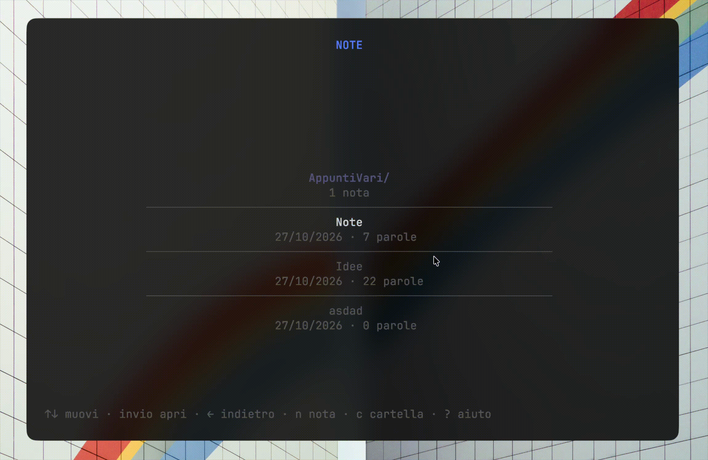

<p align="center">
  
</p>

**Nook** is a terminal markdown note editor written in Go with [Bubble Tea](https://github.com/charmbracelet/bubbletea). Notes are plain `.md` files in `~/.nook`, organised in real folders, and are written with a **Focus Line**: the line you are typing always stays in the middle of the screen as raw markdown, while the rest of the document scrolls around it already rendered (headings, bold, links, quotes, lists and checkboxes without their markers).

<p align="center">
  
</p>

## Why Nook

- **Write without distractions.** The cursor doesn't move: the text does. Your eye always stays on the same spot.
- **Real markdown, nicely seen.** Only the focused line shows raw text; the others are rendered with coloured styles and a fixed, muted palette.
- **A menu for your notes.** A list centred on the selected entry, nested folders, a trash with restore, title filter, rename and on-the-fly creation.
- **Keyboard and mouse.** Every action has a shortcut; click, double click, triple click, drag and wheel/touchpad scrolling work as you would expect.
- **Nothing hidden.** Notes are ordinary markdown files and folders in `~/.nook`: read them, back them up or sync them with any tool. Deletion is soft: a trashed note can be recovered until you delete it forever.

## Installation

Requires Go 1.26 or later.

```sh
git clone <repository-url> nook
cd nook
go build -o nook .
```

With the `Makefile`: `make build`, `make run`, `make test`, `make vet`, `make fmt`.

## Usage

```sh
./nook
```

On start-up the note list opens; from there you create, open, rename and trash
notes. Everything lives in `~/.nook` (override with `NOOK_DIR`): every note is a
`<title>.md` file and every folder is a real directory, so you can edit them with
any other editor too. Deleted notes are not erased but moved to the hidden
`~/.nook/.trash` folder, from where they can be restored. Only `.md` files and
folders are shown, any other file in the folder is left alone.

If you used an earlier version that kept notes in a SQLite database
(`notes.db`), the first start imports it into files and renames it to
`notes.db.imported`.

The interface has margins of 2 columns and 1 row on every side (reset below 30
columns or 10 rows) and a footer with the main keys; each screen has its own help
popup with the full key map.

## Note list

Entries sit in a card at most 60 columns wide, centred horizontally and vertically
on the selected entry. Each entry takes two lines: the name and, below it, a
detail (`date · N words` for notes, `N notes` or `empty` for folders). Each entry
is separated from the next by a `─` line. The title at the top is `NOOK`, with
the folder path when you go down (`NOOK › projects`), or `TRASH` in the trash view.

### Folders

Folders sit at the top of the list (name with a `/` suffix, own colour) and can be
nested. Notes are created in the folder you are currently in. Trashing a folder
sends its subfolders and all the notes it contains to the trash too; a note
restored from a trashed folder returns to the root.

| Key | Action |
|---|---|
| `↑` / `↓` | move the selection (stays centred) |
| `enter` / `→` | open the note, or enter the folder |
| `←` / `esc` | go up to the parent folder |
| `c` / `ctrl+k` | new folder |
| `n` / `ctrl+n` | new note (in the current folder) |
| `r` / `ctrl+r` | rename |
| `d` / `ctrl+d` | trash (soft delete) |
| `o` / `ctrl+o` | toggle list ↔ trash |
| `u` | restore (trash only) |
| `x` / `ctrl+x` | delete forever (trash only) |
| `f` / `ctrl+f` | filter by title |
| `?` | help |
| `q` / `ctrl+q` / `ctrl+c` | quit |

In input popups (`n`, `r`, `f`) `enter` confirms and `esc` cancels. In confirmation
popups (`d`, `x`) `y` or `enter` confirm, `n` or `esc` cancel.

Mouse: a click selects the entry, a double click opens the note or enters the
folder.

## Editor

The **Focus Line** always stays on the middle row: as you move, the text scrolls,
not the cursor. The Focus Line shows **raw** markdown; every other line is
rendered, with markers hidden (`#`, `**`, `[]()`) and coloured styles for bold,
italic, code, links, strikethrough, quotes, lists and checkboxes. Quotes
(`> text`) are italic and flanked by a vertical bar `▌` running along the whole
block, consecutive lines included — even the Focus Line, which shows the raw `>`
but keeps the bar. Lines that are not in focus use a muted palette that is
**fixed** and identical for all of them: the dimming does not depend on the
distance from the Focus Line. Long lines are truncated with `…`.

Horizontal rules (`---`, `***`, `___`) are drawn as a full-width line, and fenced
code blocks (```` ``` ```` or `~~~`) as a shaded panel closed by a top edge that shows
the language (`┌─ go ────`) and a bottom edge (`└────`); the code inside is shown
as written, with no markdown applied.

| Key | Action |
|---|---|
| `ctrl+s` / `F2` | save (confirmation toast) |
| `esc` / `ctrl+q` | back to the list; with unsaved changes opens the *Save / Discard / Cancel* popup |
| `ctrl+c` | quit immediately |
| `↑` `↓` `←` `→` | move |
| `home` / `end` | start / end of line |
| `ctrl+home` / `ctrl+end`, `ctrl+↑` / `ctrl+↓` | start / end of document |
| `pgup` / `pgdn` | page |
| `ctrl+←` / `ctrl+→` (or `alt+←` / `alt+→`) | word backward / forward |
| `shift+arrows`, `shift+home`/`end`, `shift+ctrl+←/→` | selection |
| mouse drag | select from the pressed point to the cell reached |
| `backspace` / `delete` / `enter` | delete / delete forward / new line |
| `alt+backspace` | delete the previous word |
| `ctrl+u` / `ctrl+k` | delete to start / end of line |

In the *Save / Discard / Cancel* popup: `←`/`→` choose, `enter` confirms, `esc`
returns to the editor.

The selection is visible: selected text is highlighted both on the (raw) Focus
Line and on rendered lines, where the highlight is mapped onto the markdown
segments. Typing or deleting replaces the selected text; formatting actions wrap
it.

Scrolling with the mouse wheel or a two-finger touchpad gesture moves the document
under the Focus Line, which stays where it is.

Mouse: a click makes the clicked line the Focus Line (the column is mapped onto
the raw text through the markdown segments), a double click selects the word, a
triple click the line; holding the left button and dragging extends the
selection. With the mouse enabled, native terminal selection is done by holding
`Shift` (or from the terminal's menu).

## Formatting

`ctrl+t` opens the **formatting palette**. Press the letter shown next to an entry
to apply that format at once, or use `↑`/`↓` and `enter`; `esc` (or `ctrl+t` again)
closes it without applying anything.

| | | | |
|---|---|---|---|
| `b` bold | `i` italic | `s` strikethrough | `k` code |
| `u` list | `x` checkbox | `l` link | `q` quote |
| `h` cycling heading (`#` → `##` → `###`) | `0` removes the heading | | |

With an active selection the action wraps the selected text; with no selection on
the Focus Line you can also type markdown by hand, since the text there is raw.

## Help

`ctrl+/` or `F1` opens the help popup on any screen; `?` also works from the list
(where you are not typing text). The popup is organised in tabs — **List**,
**Editor**, **Formatting**, **Mouse** and **General** — and opens on the one that
matches the current screen. Use `←`/`→` (or `tab`, or `1`–`5`) to switch tab,
`↑`/`↓` to scroll, and `esc`, `q` or `F1` to close it.

## Key diagnostics

With `NOOK_DEBUG_KEYS=1` every `tea.KeyMsg` received is appended to
`~/.nook/keys.log` (one line per key, with `Type`, `Runes`, `Alt`, `Paste` and
`String`), useful to see what your terminal actually sends. Messages the
application doesn't recognise are logged as well — for example unknown escape
sequences (CSI), which bubbletea delivers as generic messages — in the format:

```
Type=%T Val=%q
```

that is, the Go type of the message and its quoted value (one line per message).
Messages that are already handled (`WindowSizeMsg`, `KeyMsg`, `MouseMsg` and the
ticks that dismiss toasts) don't end up in this log: keys stay recorded in the
`logKey` line. Without that variable (or with a value other than `1`) nothing is
written and the file is not created.

```sh
NOOK_DEBUG_KEYS=1 ./nook
```

## How it was built

The basic structure of Nook has been created **exclusively with the coding agent [Orcrist](https://github.com/simone20a/Orcrist)**, using only the **DeepSeek Flash** and **DeepSeek Pro** models.
